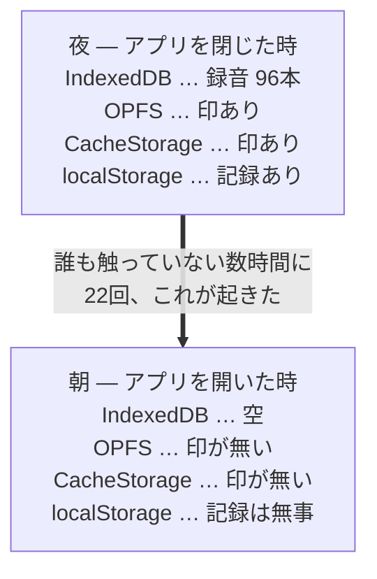
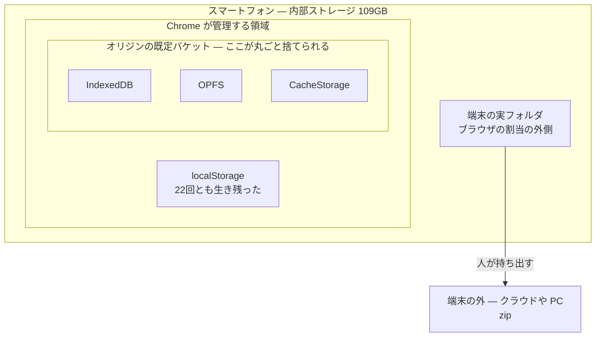
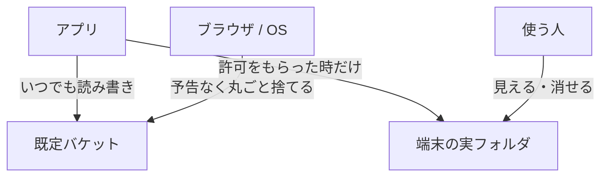

歌の練習用PWAを個人で作っています。録音した自分の歌を IndexedDB に保存するアプリです。

そのIndexedDBが、**2026年7月11日から9月22日までのあいだに22回、中身ごと消えました。** 曲もフレーズも録音も、全部ゼロになります。最も多いときで**録音195本**が一度に消えました。

**原因は、今も分かっていません。**

途中で二回、「分かった」と思って二回とも間違えました。この記事はその記録です。原因究明の成功譚ではありません。**原因が分からないまま、それでもデータを守る側に何ができるか**という話です。

他の人の役に立ちそうなことを先に三つ書いておきます。

1. **`navigator.storage.estimate()` の `quota` は端末の空き容量ではありません。** 私はこれを二ヶ月近く取り違えたまま、17件ぶんの調査記録に誤った前提を書き続けました。
2. **IndexedDB・OPFS・CacheStorage は同じ箱の住人です。** 片方からもう片方へ「逃がす」ことはできません。実測で二度とも道連れでした。
3. **いちばん怖かったのは消失そのものではなく、私が書いた「守り」のほうでした。** 守りがユーザーのバックアップを消しかけ、守りの計器が「全部守られています」と嘘をつきました。どちらも実際に起きています。
:::message
**長い記事です（約14,000字）。** 中身は上の三つに対応した、独立に読める三つの話です。必要なところだけ読んでいただければ充分です。

| 読みたいこと | 行き先 |
|---|---|
| ブラウザのデータは**どこに、どう置かれているのか**（オリジン／バケット／`quota` の正体） | [端末の中のどこに、何が在るのか](#%E7%AB%AF%E6%9C%AB%E3%81%AE%E4%B8%AD%E3%81%AE%E3%81%A9%E3%81%93%E3%81%AB%E3%80%81%E4%BD%95%E3%81%8C%E5%9C%A8%E3%82%8B%E3%81%AE%E3%81%8B) |
| **22回をどう調べ、二度読み違えたか**（n=1 の観測で因果を語るとどうなるか） | [どうやってそこに辿り着いたか](#%E3%81%A9%E3%81%86%E3%82%84%E3%81%A3%E3%81%A6%E3%81%9D%E3%81%93%E3%81%AB%E8%BE%BF%E3%82%8A%E7%9D%80%E3%81%84%E3%81%9F%E3%81%8B) |
| **バックアップや掃除のコードを書く人へ** ―― 自分の守りがデータを消し、計器が二度嘘をついた話 | [いちばん怖かったのは、消失ではなく私の書いた守りでした](#%E3%81%84%E3%81%A1%E3%81%B0%E3%82%93%E6%80%96%E3%81%8B%E3%81%A3%E3%81%9F%E3%81%AE%E3%81%AF%E3%80%81%E6%B6%88%E5%A4%B1%E3%81%A7%E3%81%AF%E3%81%AA%E3%81%8F%E7%A7%81%E3%81%AE%E6%9B%B8%E3%81%84%E3%81%9F%E5%AE%88%E3%82%8A%E3%81%A7%E3%81%97%E3%81%9F) |

三つ目は消失の話をほとんど必要としません。**そこだけ読んでも通ります。**
:::

## まず、何が起きたかを一枚で



**三つが揃って空になり、一つだけ生き残ります。** アプリは何もしていません。前回はきれいに接続を閉じて終わっていて、その後は一度も開いていない。`persisted: true`（永続化の許可）も毎回取れています。

この記事は、**この不思議な線引きが何なのか**、**なぜ三つ同時に消えるのか**、そして**私が二度なにを読み違えたか**の記録です。

## 端末の中のどこに、何が在るのか

上の四つは、端末の中のどこに在るのでしょうか。まず**位置**からです。



箱の中の三つが、それぞれ何を持っているかというと ―― **IndexedDB** が曲・フレーズ・録音の本体、**OPFS** は逃げ場の候補として試した先、**CacheStorage** は PWA が自分自身を置いておく場所です。

**そしてこの三つは、同じ一つの箱の中の住人です。** だから「IndexedDB が危ないので OPFS へ逃がそう」は成立しません。箱ごと捨てられるからです。

`localStorage` は Chrome の管理下にありますが、**実測では22回とも道連れになりませんでした**（仕様がそう保証しているわけではなく、あくまで私の端末で観測された振る舞いです）。だから消失ログと構造の控えはそこに置いています ―― **消えた側に記録を置いても、記録ごと消えるので。**

:::message
**用語：オリジン、バケットと「既定バケット」**

まず**オリジン**から。ドメインに似ていますが、もう少し厳しい単位です。**スキームとホストとポートの三つ組**で、
三つとも一致して初めて「同じオリジン」になります。

| | 同じオリジンか |
|---|---|
| `https://example.com` と `http://example.com` | **別**（スキームが違う） |
| `https://example.com` と `https://app.example.com` | **別**（ホストが違う） |
| `https://example.com` と `https://example.com:8443` | **別**（ポートが違う） |

**ブラウザの保存領域は、このオリジンごとに完全に分かれています。** 別のオリジンなら、棚も、バケットも、
localStorage も、まるごと別物です。

これは私の調査でも効きました。途中で置き場所を自宅サーバ（`…ts.net:8443`）から Vercel
（`utaloop.vercel.app`）へ移したのですが、**消失ログも別々に積まれます**。移した先の記録だけを見て
「静かになった」と思っていたら、**古い方の蔵に7日間読まれないまま1件積まれていた**、ということがありました。

さて、バケットの話です。Storage Standard では、ブラウザはオリジンごとに**棚**を持ち、その棚に**バケット**が並ぶ、と定めています。
何もしなければバケットは**一つだけ**で、それが**既定バケット**です。

**IndexedDB・CacheStorage・OPFS は、それぞれ独立した保管庫ではありません。** どれも
「既定バケットの中の一区画」として置かれています。つまり構造はこうです。

```
オリジン（https://example.com）
  └ 既定バケット          ← 容量の割当・永続性・退去の判定は、この単位で行われる
      ├ IndexedDB
      ├ CacheStorage
      └ OPFS
```

**退去（eviction）も削除も、この箱の単位で起きます。** 中身を一つだけ選んで捨てる仕組みではありません。
だから「IndexedDB が危ないので OPFS へ」は、同じ箱の中での引っ越しにしかなりません。

補足を三つ。

- **`navigator.storage.persist()`** で `persisted: true` を取ると、この既定バケットが persistent になります。
  ただし仕様上これが守るのは**容量逼迫による自動退去**からであって、あらゆる消え方を防ぐものではありません
  （実際、私の22回はすべて `persisted: true` の状態で起きています）。
- **Storage Buckets API**（`navigator.storageBuckets.open()`）を使えば、名前付きのバケットを追加で作れます。
  バケットごとに永続性や期限を分けられるのですが、**同じ quota の層の下にある**ので、
  「別のバケットへ逃がせば助かる」とは考えにくく、私は採りませんでした。
- **localStorage** は、仕様の上では同じ棚の住人として書かれています。けれど Chromium の実装では
  別系統の保存庫に置かれており、名前付きバケットへ分割することもできません。
  **私の22回で localStorage だけが生き残ったのは、この実装上の分離とよく符合します**
  ―― ただし、仕様がそれを保証しているわけではありません。

実機で中を覗きたいときは `chrome://quota-internals` を開くと、バケットの一覧と最終更新が見られます。
:::

次に、**誰が触れるのか**です。



`localStorage` と zip も含めて表にすると、こうなります。

| 置き場所 | アプリから | 使う人から | ブラウザ / OS から |
|---|---|---|---|
| 既定バケット（IndexedDB ほか） | いつでも読み書き | 見えない | **予告なく丸ごと捨てられる** |
| localStorage | いつでも読み書き | 見えない | 実測では捨てられなかった |
| 端末の実フォルダ | **許可をもらった時だけ**書ける | ファイルアプリで見える | 捨てない |
| zip（端末の外） | 書き出すだけ | 自由に扱える | 関与しない |

ここで効いてくるのが**右の二列**です。バケットの中身は、消えるまで**誰の目にも触れません**。使う人は自分の録音がどこにあるのか見えないし、消えたことにも気づけない。**フォルダへ出した瞬間に、初めて「自分で扱えるもの」になります。**

サーバはありません。ログインもありません。**録音は一度も端末の外へ出ません** ―― それがこのアプリの売りなのですが、裏を返すと**消えたら誰にも復元できない**ということでもあります。

## どうやってそこに辿り着いたか

ここまでが**今の理解**です。ここからは、どうやってそこへ辿り着いたかを書きます。

最初は「IndexedDBが壊れたのだろう」と思っていました。接続の切り方が悪いのか、書き込み中に落ちているのか。**箱という単位があることも、その時は知りませんでした。**

そこで、消えたときに何が起きていたのかを後から読めるように、**目を五つ**置きました。

| 置いた目 | 何が分かるか |
|---|---|
| 構造ミラー（localStorage） | 曲とフレーズの控え。消えても構造だけは戻せる |
| 消失ログ（localStorage） | 何がいくつからゼロになったか、いつか、どの版か |
| セッションの終幕記録 | 前回アプリがどう閉じたか（きれいに閉じたか、凍結されたか） |
| **OPFS カナリア** | OPFS に置いた印。生きていれば OPFS は無事 |
| **区画カナリア**（CacheStorage） | CacheStorage に置いた印。同上 |

加えて、印を**刻めたかどうか**の台帳も取りました。「刻めずに終わった夜」と「刻んだのに消された夜」を区別できないと、何も証明できないからです。

12回目の消失で、答えが出ました。

```
IndexedDB        → 空
OPFS カナリア     → LOST（領域は開けたが印が無い）
区画カナリア      → LOST（同上）
localStorage     → 生きている
刻みの成否        → failedAt=(none)（刻めなかったのではない）
persisted        → true
```

**IndexedDB・OPFS・CacheStorage が揃って更地になり、別系統の localStorage だけが生き残っていました。** しかも印は「刻めなかった」のではなく「刻んだものが消された」。

つまり壊れているのは蔵（IndexedDB）ひとつではありません。**このオリジンに割り当てられたストレージが、区画ごと捨てられている。**

**冒頭の図の、あの不思議な線引きの正体がこれでした。** 三つは同じ箱の住人で、localStorage だけが箱の外に居た ―― それだけのことだったのです。

この署名は、以後の消失でも寸分違いませんでした。**そして localStorage は22回とも生き残っています** ―― その証拠がこの消失ログそのものです。22件の記録が localStorage に積み上がって残っているということは、22回とも localStorage が死ななかったということですから。

## これで消えた見立て

数字が出たことで、いくつかの仮説が死にました。

**`persisted: true` は効きません。** 永続化の許可は毎回取れていました。永続化が防ぐのは容量逼迫による追い出しであって、この捨てられ方は防いでくれませんでした。

**アプリの終了処理が甘いのでもありません。** 何度かは、前回のセッションが `db.close()` まで到達して綺麗に閉じていました（`clean-close`）。その後アプリは一度もDBを開いていません。**誰も触っていない時間に更地になっています。**

**OPFS へ逃がす案も死にました。** これが一番痛かったところです。「IndexedDBが捨てられても OPFS は生き残るだろう」という前提で移行を検討していたのですが、カナリアを置いて実測したら**二度とも道連れ**でした。同じ区画にある以上、逃げ場になりません。名前付き Storage Bucket も同じ層の下なので、期待は薄いと判断しました。

**「バージョン更新のときに壊れる」でもありませんでした。** 消失の多くは新しいビルドを掴んだ直後に見つかるので、最初は更新が引き金だと思っていました。でも逆です ―― 区画が捨てられればキャッシュ（precache）も道連れになるので、次の起動は必ず新しい版を取りに行きます。**更新跨ぎは病の影であって、病ではありませんでした。** 実際、版が変わっていない状態で消えた回も複数あります。

**オリジン固有でもありませんでした。** 自宅サーバ（Tailscale 経由）で動かしていたものを Vercel に移して様子を見ましたが、**移した先でも同じ署名で3回消えました。**

さらに、**23日間ただの一度も開いていない**オリジンの蔵を検分したら、そちらも消えていました。「使っているから捨てられる」でもないわけです。

## 読み違い その一 ―― `quota` を端末の空きだと思っていました

上の調査のあいだ、私はずっと診断情報にこう書いていました。

```
pressure: usage=0MB quota=10240MB (0%)
```

**「ストレージ逼迫度 0%」。空きは十分にある。だから容量の問題ではない。** ―― 17件ぶんの記録に、私はそう書き続けていました。

これが間違いでした。

この数字は `navigator.storage.estimate()` の `usage` と `quota` です。そして **`quota` は端末の空き容量ではありません。** あれは「このオリジンが使ってよい上限」であって、Chromium が計算して割り当てた数字です。**端末そのものの空きとは別の物差しなのに、私はそれを端末の空きだと思って読んでいました。**

8月25日、`chrome://quota-internals` を実機で開いて、初めて本当の数字を見ました。

```
端末の総容量 : 109.47 GB
端末の空き   : 1.58 GB（1.4%）
```

**端末はほぼ満杯でした。** 「空きは9割以上ある」どころか、残り1.4%です。

Web の API からは端末の空き容量は読めません。だから診断パネルにも出せず、私は代わりに読める数字（オリジン単位の使用率）を見て、**読めない数字を見た気になっていました。**

## 空けてみたら、止まりました ―― と、三週間だけ思いました

そこで実験をしました。**端末の空きを 1.58GB から 7GB 程度まで空けて、消失が続くかどうかを見る。**

9月17日の時点では、こう見えていました。

| | 空ける前 | 空けたあと |
|---|---|---|
| 消失の間隔 | 12日 → 7日 → 3日16時間 → **16時間** と加速していた | **3週間以上ゼロ** |
| 抱えている録音 | 消失時の最大が96本 | **191本**を一度も失わずに保持 |
| 区画カナリア | 毎回 `LOST` | 400回以上の書き込みを生き延びている |

16時間まで縮んでいたところからの3週間です。私はこれを「強い示唆」だと思いました。実際、この時点の記事の草稿にはそう書いていました。

**9月19日、録音195本が消えました。** 空きは 6.9GB のままです。

```
消失⑳  2026-09-19 13:29
  空き容量      : 6.9GB（空ける前の4倍以上）
  persisted     : true
  前回の終わり方 : clean-close
  区画カナリア   : LOST
  録音          : 195 → 0（過去最大）
```

**署名は、それまでの19件と寸分違いませんでした。**

そして間隔は、**ここからまた縮みました**。⑳の34時間後に㉑、その24時間後に㉒。**三日で三度**です。㉒で消えたのは、⑳で失ってフォルダから戻した**まさにその195本**でした。

24日の沈黙は、強い示唆ではなく**ただの長い間隔**でした。過去にも 12日、7日という間隔はあったのです。私は手元にあるいちばん長い沈黙を見て、原因を掴んだ気になっていました。

**「空けたら止まる」は取り下げました。** 二つ目の読み違いです。

:::message alert
**n=1 の観測で因果を語ると、こうなります。**

一つ目の読み違い（`quota` を端末の空きだと思った）は、**仕様を誤読していた**という単純な間違いでした。直せば済みます。

二つ目（空けたら止まった）はもっと厄介です。**数字そのものは本当**だったからです。間隔は確かに16時間から3週間に伸びた。嘘は一つもありません。それでも結論は誤りでした ―― **滅多に起きないことの「起きなかった期間」は、何の証拠にもならない**からです。

私はこれを二回やりました。一回目で学んでいれば二回目は防げたはずですが、防げませんでした。
:::

## 原因が分からないまま、どう設計するか

ここで方針を変えました。**原因究明を待つのをやめました。**

分かっていることだけを並べると、こうです。

- 捨てられる単位は**オリジンの既定バケット**（IndexedDB・OPFS・CacheStorage が同時に死ぬ）
- `persisted: true` は効かない
- オリジンを変えても起きる。23日間開いていないオリジンでも起きる
- 容量を空けても起きる
- **間隔は16時間から24日まで大きく揺れ、その揺れが何で決まるのかは読めていない**

そして、ここが分かれ目でした。**私が使っている端末は Pixel 9a です。** 発売中の、ごく普通の Android です。

「この端末が特殊だから」という逃げ道は、ここで閉じました。**代表的な端末で起きるなら、それは珍しい端末の珍しい病ではありません。** 公開しているアプリである以上、**使ってくれる人の端末でも起こり得るものとして設計し、そう書く**しかない ―― そう決めました。

## 結局どう設計したか

**区画ごと捨てられるのなら、逃げ場は区画の外にしかありません。** IndexedDB も OPFS も CacheStorage も同じ区画の住人なので（上の図の内側の箱です）、その中でいくら引っ越しても意味がない。そこで二段構えにしました。

1. **端末内の実フォルダへ控える**（File System Access API）。置き場所を一度選んでもらえば、録音のたびにフォルダへも書きます。ここはブラウザの割当ストレージの外なので、区画が捨てられても残ります。
2. **zip で端末の外へ書き出す**。機種変更や端末そのものを失う備えです。

そのうえで、**「まだ外へ出していない録音が何本あるか」を画面に出す**ことにしました。22回の消失を振り返ると、失われた録音の多くは「退避できなかった」のではなく「**退避されないままだった**」からです。組めたはずの退避が組まれなかった。アプリがそれを誰にも告げていなかったのが、いちばんの設計の失敗でした。

### 働きました

9月19日、録音195本が消えた回。**フォルダの控えが区画の外で生き延びていて、195本すべてが戻りました。**

三ヶ月で初めてです。それまでの19回は、消えたものは消えたままでした。

ここで終わっていれば良かったのですが、終わりませんでした。

## いちばん怖かったのは、消失ではなく私の書いた守りでした

ここまでは消失の話でした。ここからは、私が書いたコードの話になります。

### 守りが、守るはずのものを消しました

バックアップ処理には「掃除」が付いています。IndexedDBから消えた録音の控えをフォルダからも消す ―― そうしないとフォルダが古いファイルで膨らみ続けるからです。

9月19日の消失のあと、私はこの掃除に安全弁を付けました。

```js
// 初版の安全弁
const catastrophic = wanted.size === 0 && present.size > 0
// 「DBが空っぽなのにフォルダには在る」＝異常。一本も消さずに引き返す
```

区画が捨てられた直後はDBが空になります。その状態でフォルダをDBに揃えれば、生き残った控えを全部消してしまう。だからDBが**空のとき**は掃除しない ―― そういう弁です。

**これが足りませんでした。**

```
09-21 15:21  区画の消失（録音 195 → 0）
09-24 02:43:35  ユーザーが3本録音した     ← DBはもう「空」ではない
09-24 02:43:52  バックアップが走った
                 掃除「DBには3本。フォルダの195本は不要な控えだ」
                 → 195本の控えを削除
09-24 03:13     弁を広げた修正版をデプロイ   ← 30分 遅い
```

**区画の病が消したのではありません。私が書いた守りが消しました。** ユーザーが別のフォルダにも控えを取っていなければ、195本は永久に失われていました。

9月19日に助かったのは、実はフォルダへのハンドル（これもIndexedDBに住んでいます）が道連れになって**同期が走れなかった**からでした。偶然です。そして私は、その偶然に二度目も頼っていたことになります。

修正は、弁を**一点から帯へ**広げることでした。

```js
// 「一度に大量を消す掃除」自体を異常の兆候とみなす
const threshold = Math.max(3, Math.floor(present.size * 0.2))
const massCleanup = staleNames.length > threshold
```

**一点で張った弁は、現実が半歩ずれただけで素通りします。** DBが「空」から「3本」になっただけで、弁は何の役にも立ちませんでした。

### 計器が「全部守られています」と嘘をつきました

同じ日、診断情報にこう出ていました。

```
exposure: unbacked=0/199     ← 未バックアップ 0本。全部守られている
lastExportedAt: 2026-09-24T03:04:11
```

ところが **03:04 の時点でDBに在った録音は3本**でした。その後に戻した195本は、いずれのzipにも入っていません。

なぜ「0本」と出たのか。未バックアップの数え方がこうだったからです。

```
最後にエクスポートした時刻より新しい録音 = 未バックアップ
```

これは「**古いものは、あの時のzipに入っていたはずだ**」という**推定**です。復元で戻ってきた録音は作成時刻が古いので、「入っていたはず」と数えられました。入っていないのに。

**守りは在ったのに、計器が嘘をついていました。** そして計器が嘘をつけば、ユーザーは安全だと思って何もしません。守りは在っても働きません。

直し方は、**推定をやめて台帳を持つ**ことでした。「どの録音が現に外に在るか」をIDで記録する。時刻ではなく身元で数える。台帳は（22回生き残った）localStorage に置きました。

### その計器が、もう一度嘘をつきました

台帳はフォルダの実情で照合します。同期のたびにフォルダを一覧し、そこに無いIDは「外に在る」印を落とす ―― そうしないと、さっきの「守りが控えを消した」ような事故に気づけないからです。

10月7日、ユーザーからこう言われました。

> 今日バックアップして、それから55本も録っていないのに「未バックアップ 55本」と出るのは何故ですか

録音が増えたのではありませんでした。**台帳の印が剥がされていたのです。**

```js
// フォルダを一覧して、その結果を呼び出し元へ返す
res.presentIds = [...(after ?? [])].map(toRecordingId).filter(Boolean)
//                        ^^^^^^^
//                        一覧に失敗して null が来たとき、
//                        これは [] になる ＝「検めた。フォルダは空だった」
```

フォルダを開く権限はユーザー操作のたびに要求します。録音のたびに走る自動同期は、そのセッションでまだ許可を取っていなければ**ディレクトリを開く時点で失敗します**。そのとき返り値の初期値が `presentIds: []` でした。

呼び出し元は `[]` を受け取り、「フォルダは空だ」と読み、**フォルダに199本が現に在るまま台帳の印を全部剥がしました。**

**「読めなかった」が「空だった」に化けていたのです。**

直したのは二箇所です。

```js
// ① 初期値から外す。undefined ＝「まだ検めていない」
//    呼び出し元の if (res.presentIds) が、ここで初めて意味を持つ

// ② 書くべきものが在ったのに一つも見えない、は「空」ではなく「異常」
//    この関数は無いファイルを*書いてから*数えるので、
//    実在0 は「空になった」ではなく「書き込みが全部失敗した」か「一覧が嘘をついた」
if (ids && !(ids.length === 0 && wanted.size > 0)) res.presentIds = ids
```

この手の間違いには、同じ形があります。半年前にも一度やっていました ―― フォルダに置き場所を作れなかったとき、失敗数 `failed: 0` のまま黙って返していて、呼び出し元が `failed === 0` を成功と読んでいた。**一本も書かずに「成功しました」と名乗る守り**です。

**「何もしなかった」を「成功」と呼ばない。「読めなかった」を「空」と読まない。** 同じ掟の、違う顔でした。

### この三つに共通していたこと

| 何が起きたか | 本当の問題 |
|---|---|
| 掃除が控えを消した | 弁を「最悪の一点」で張っていた（半歩ずれたら素通り） |
| 「0本」と嘘をついた | **推定**を測定値のように見せていた |
| 「55本」と嘘をついた | **失敗**を測定値（空）として扱っていた |

三つとも、**守りの側のコード**です。消失そのものより、こちらのほうが怖い。消失は外から来ますが、これは自分で書いて自分でデプロイしています。しかも**ユーザーには「守られている」と見える顔をしている**ぶん、質が悪い。

**守りは、守る対象を壊す力を併せ持ちます。** 削除する力・数を告げる力を持つ経路には、それ自体を疑う弁が要ります。

## 今どうなっているか

公開する直前に、実機の診断情報を採りました。2026年10月19日です。

```
counts: songs=13 phrases=70 recordings=289 takes=290
bucketCanary: found firstWrittenAt=2026-09-21T15:21:08Z writes=401
persisted: true
exposure: unbacked=0/290
```

最後の消失は **9月22日**（UTC で 9月21日15:21）。そこで蒔き直した区画カナリアが、**401回の書き込みを生き延びて、まだ在ります。** 録音は195本から**289本**まで増えて、一本も失っていません。**27日間です。**

**過去最長の間隔である24日を、超えました。**

**それでも「止まった」とは書きません。**

24日の沈黙を「強い示唆」と呼んで外したのが、ちょうど一ヶ月前です。間隔は16時間から24日まで揺れていて、**その揺れが何で決まるのかは今も読めていません。** 読めない揺らぎの、たまたま手元にあるいちばん長い端を見て結論を出す ―― それが二度目の読み違いそのものでした。三度目はやりません。27日は、いまのところ**ただの27日**です。

最後の一行の `unbacked=0/290` は、**推定ではありません。** 290本ぶんのIDが「現に外に在る」と台帳に記録されていることを数えた 0 です。二度嘘をついた計器は、今はこうなっています。

分かっているのは、9月19日に初めて**消えたものが戻った**ということだけです。原因は分からないままですが、**戻せる状態は作れました。**

## 持ち帰ってもらえるとしたら

**`navigator.storage.estimate()` の `quota` を端末の空き容量として読まないでください。** あれはオリジンへの割当であって、端末の残量ではありません。混同すると、私のように「容量は十分だ」という誤った前提の上に調査を積み上げることになります。端末の空きを知りたいときは、Web の API では届きません（開発中なら `chrome://quota-internals` で見られます）。

**`persisted: true` は「消えない」ではありません。** 防いでくれるのは容量逼迫による追い出しだけで、区画ごと捨てられる場合には効きませんでした。

**OPFS は IndexedDB のバックアップ先になりません。** 同じ区画にあるので一緒に消えます。逃がすなら区画の外へ。

**滅多に起きないことについて、「起きなかった期間」を証拠にしないでください。** 私はこれで二回間違えました。n=1 の観測で因果を語るには、沈黙は短すぎます。

**そして、守りを書いたら、守りを疑ってください。** バックアップ処理・クリーンアップ処理・「安全です」と表示する処理は、**データを壊す力と、嘘をつく力を持っています**。私の三ヶ月で実際に危なかったのは、22回の消失よりも、この三つのほうでした。

- 削除する経路には、**異常の帯**で弁を張る（一点ではなく）
- 「安全です」と告げる数字は、**推定ではなく実測**で出す
- **失敗を、測定値として扱わない**（読めなかった ≠ 空だった）

ブラウザに置いたユーザーデータは、いつか消える前提で設計するしかない ―― と今は思っています。消えないようにする努力より、**消えたときに何が失われるかを見せておく**ほうが、結果的にデータを守ってくれました。ただしその「見せる」仕組みが嘘をついていないかは、別途ちゃんと確かめないといけません。私は二回つかれました。

---

このアプリは[うたループ](https://maruhuku.jp/products/utaloop/)という名前で公開しています。消失の件はプロダクトページにも書いています。隠して使ってもらっても、消えた日にいなくなるだけなので。
